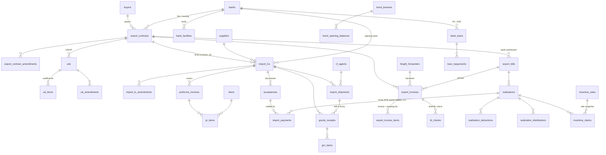

# Database schema

PostgreSQL (Supabase). Each fact is stored once. Everything else is calculated in views, including BTB balance, open liability, maturities, due dates, bond balances and incentive amounts.

## Rules every table follows

| Rule | How it is enforced |
|---|---|
| `status, created_by, created_at, updated_by, updated_at` on every record | `app.setup_table()` adds the columns, and the `*_stamp` trigger fills them. Users cannot type them. |
| Nothing is hard-deleted | The `*_nodel` trigger blocks deletes, there is no RLS delete policy, and `DELETE` is revoked. Records are voided with `status = 'void'` and a required `void_reason`. Only the GM can restore a voided record. |
| Audit log of who changed what | The `*_audit` trigger writes `audit_log` (only the changed fields, old and new values, user, time). |
| Role-based access | RLS on every table. Any active user can read. Writes follow `role_permissions` (GM can write everything; Management is read-only). |
| Files on any record | `attachments(entity_table, entity_id, …)` plus the private storage bucket `attachments`. |
| Currency | Each money row stores its own currency. `currency_rates` (BDT per unit, by date) drive `app.convert()`. Payments and realizations store the actual rate used and a generated `amount_bdt`. |

## Entity-relationship diagram

## Tables

### Foundation
| Table | Key fields |
|---|---|
| `profiles` | id (= auth user), email, full_name, role, is_active |
| `role_permissions` | table_name, role (who may create/edit) |
| `app_settings` | key, value (JSON): `company`, `alerts`, `template.bond_statement`, `template.incentive_claim` |
| `audit_log` | table_name, record_id, action (INSERT/UPDATE/VOID/RESTORE), old_data, new_data, changed_by, changed_at |
| `attachments` | entity_table, entity_id, doc_type, file_name, storage_path, mime_type, size_bytes |

### A. Masters
| Table | Key fields |
|---|---|
| `currencies` | code (PK), name, symbol |
| `currency_rates` | currency_code, rate_date, rate_to_bdt, source |
| `units` | code (PK), name |
| `hs_codes` | code, description, unit |
| `banks` | name, branch, swift, is_local, bank_roles[] (lien / opening / issuing / advising / negotiating), account_no |
| `bank_facilities` | bank, facility_type (BTB / EDF / PC / FDBP / UPAS / OTHER), is_funded, limit_amount, currency, validity, sanction_ref |
| `buyers` | code, name, address, country, market (for incentive), VAT/EORI |
| `suppliers` | code, name, origin (local/foreign), category, country |
| `cf_agents` | name, license_no, ports[] |
| `freight_forwarders` | name, license_no |
| `items` | code, name, category, unit, hs_code, is_bonded |

### B. Export contract (Master LC / Sales Contract)
| Table | Key fields |
|---|---|
| `export_contracts` | contract_no, type (LC/SC), buyer, issuing bank, lien bank, currency, value, tolerance %, quantity, issue / last shipment / expiry dates, lien date & ref, payment terms, **tenor_days + tenor_basis** (export bill due date), incoterm, ports, destination, product category, **btb_entitlement_pct**, consignee / notify text (used by the BL check) |
| `export_contract_amendments` | amendment_no, date, value_change, quantity_change, new LSD / expiry / tolerance |
| `uds` | UD/UP, BGMEA/BKMEA, number, date, garment qty |
| `ud_amendments` | amendment_no, date, description |
| `ud_items` | material, **coefficient per dozen** (incl. wastage), entitled qty: used for bond consumption |

`v_export_contracts` calculates the current value, LSD and expiry after amendments, **BTB entitlement, BTB opened, BTB awaiting approval, BTB balance, open BTB liability, shipped value, balance to ship and realized value**, plus USD equivalents.

### C. Sourcing and import / BTB LC
| Table | Key fields |
|---|---|
| `proforma_invoices` | pi_no, date, supplier, currency, for Master LC, covered by import LC |
| `pi_items` | item, quantity, unit, unit_price, amount (generated) |
| `import_lcs` | lc_no, application no/date, **contract_id (set = BTB)**, supplier, bank, payment_type (sight / deferred / UPAS / EDF / cash), currency, value, tolerance, opening date, LSD, expiry, **tenor_days, tenor_basis** (acceptance date / BL date). Trigger-calculated: `exceeds_entitlement`, `lsd_after_master`, `approval_status` |
| `import_lc_amendments` | amendment_no, date, value_change, new LSD / expiry |
| `acceptances` | import LC, supplier invoice, document value, docs received, BL/AWB no & date, acceptance date, **maturity_date (always calculated by trigger)** |
| `import_payments` | acceptance, payment date, amount, exchange rate, amount_bdt (generated), bank charges, source (export proceeds / EDF / own fund / UPAS / other), **realization_id** |

Business rules (database triggers):
- If the BTB total would exceed the Master LC's entitlement, the LC is flagged and set to **pending GM approval**. It cannot be marked *Opened* until the GM approves it (`approve_import_lc()`). Only the GM can record an amendment that pushes BTB over entitlement.
- An import LC whose LSD is later than the Master LC's LSD is flagged.
- Maturity = (acceptance date or BL date, per the LC) + tenor days. A typed value is overwritten. If the LC tenor changes, maturities are recalculated.
- Total acceptances cannot exceed the LC value plus tolerance. Payments cannot exceed the accepted value.

### D. Import shipment and port clearing
`import_shipments`: import LC, supplier invoice, mode, vessel/flight, BL/AWB no & date, containers, ETD, ETA, arrival, port, **free days**, C&F agent, Bill of Entry no & date, assessable value, duty paid, release date, and a 6-document checklist.
`v_import_shipments` calculates days at port and **demurrage risk** (high once free days have passed, medium within 2 days of the limit).

### E. Goods receipt
`goods_receipts` (GRN no/date, import LC, shipment/Bill of Entry, challan, store) and `grn_items` (item, qty, unit).
`v_lc_item_receipts` compares LC quantity (from PIs) with received quantity and shows short or excess.

### F. Export documentation
| Table | Key fields |
|---|---|
| `export_invoices` | contract, invoice no/date, PO, EXP no/date, **shipping bill / Bill of Export no/date**, ports, vessel, container, marks, port submission date, **handover to forwarder (date, cartons, CBM)**, FCR no, draft BL received, **final BL no/date, BL collection date**, export_bill_id |
| `export_invoice_items` | style, description, HS, colour, qty, unit price, amount (generated), cartons and carton range, net/gross weight, CBM: invoice and packing list in one place |
| `bl_checks` | invoice, date, draft ref, results (field-by-field expected vs draft and pass/discrepancy), overall result |

### G. Bank submission and realization
| Table | Key fields |
|---|---|
| `export_bills` | contract, bank, submission date, FDBC/FDBP/LDBC/LDBP, bill ref, buyer acceptance / docs receipt date, courier, negotiation date, purchase amount & rate |
| `realizations` | export bill, date, realized amount, exchange rate, amount_bdt, ERQ %, is_final (closes the bill), PRC no/date |
| `realization_deductions` | reason (foreign / local bank charges, discount/claim, short shipment, commission, freight, other), amount |
| `realization_distributions` | head (PC adjustment, ERQ, FC, CD, EDF repayment, bank charges, other), amount |

BTB payments made from proceeds are rows in `import_payments` with `realization_id` set. The database only allows them for BTB LCs under **the same Master LC**, and only up to the realized amount. This is what lowers that Master LC's open BTB liability.
`v_export_bills` calculates the bill value from its invoices, **due date = basis date + contract tenor**, realized, outstanding, short realization, and status (under realization / partly realized / overdue / realized).

### H. Customs bond
`bond_licenses`, `bond_opening_balances` (per material, as of date).
Functions: `bond_import_entries(from,to)` (Bill of Entry wise, from GRNs), `bond_export_entries(from,to)` (Bill of Export wise, export pcs ÷ 12 × UD coefficient), `bond_statement(license,from,to)` (opening + imports − consumption = closing per material).

### I. Cash incentive
`incentive_rates` (scheme, product, market, rate %, effective from/to, circular ref).
`incentive_claims` (realization, scheme, claim no, base amount, **rate and amount snapshot set by trigger** from the rate valid on the shipment date, 9-document checklist, submission date, auditor certificate date, status, amount received).
`v_incentive_eligible` lists realized shipments with an applicable scheme and no claim yet.

### Phase 4 / reporting
`bank_loans` + `loan_repayments` (PC and EDF loans), `alert_log`.
Views: `v_bank_utilization` (limit vs used per facility, funded and non-funded), `v_alerts` (every due item; thresholds in settings), `v_documents` (document store search).
